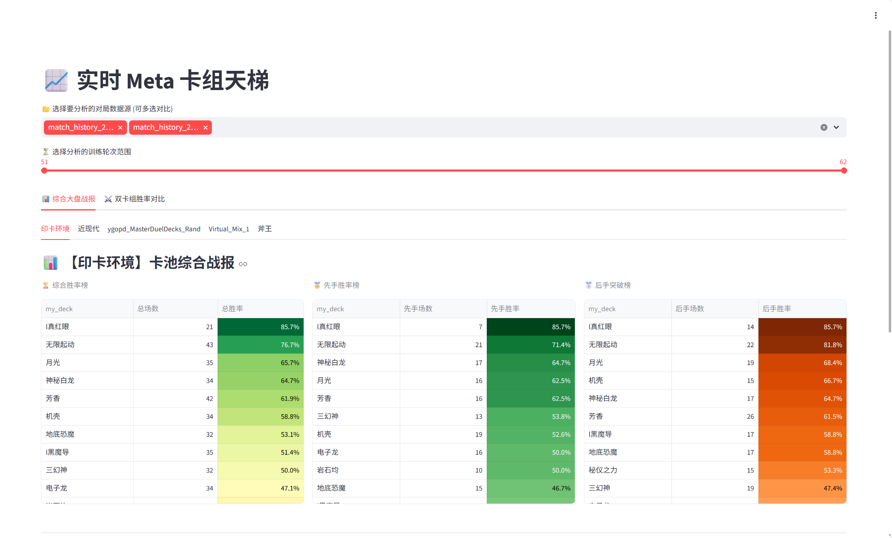
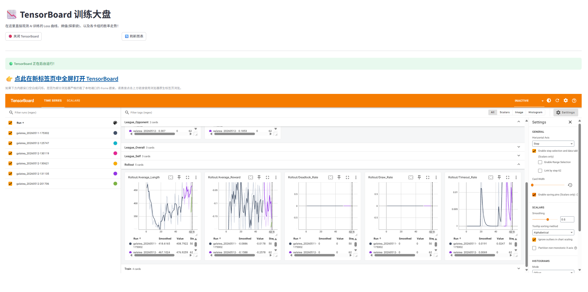
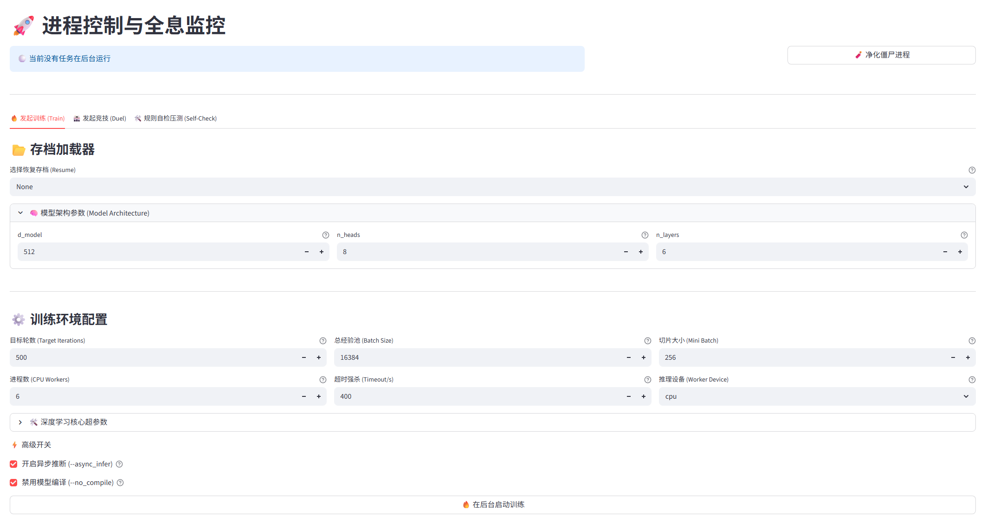
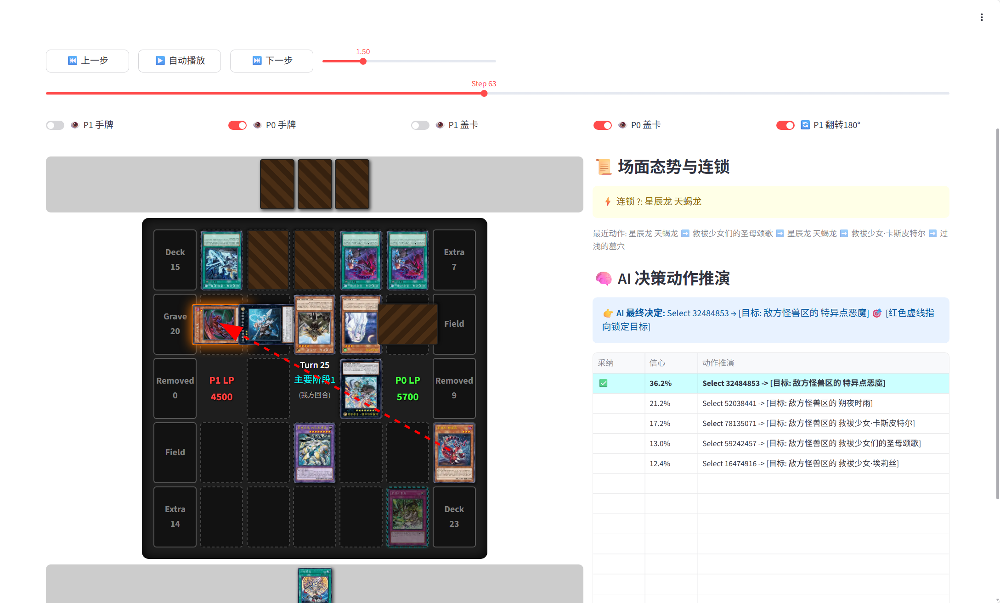

<div align="center">


# Galatea-Core

**基于 Transformer + PPO 的游戏王通用 AI 训练框架**

[](https://www.gnu.org/licenses/gpl-3.0)
[](docs/changelog.md)
[](docs/architecture.md#精确卡片身份model-protocol-v4)
[](https://www.python.org/downloads/)
[](https://pytorch.org/)

[English](README_EN.md) | 简体中文

</div>

---

## ✨ 特性亮点


- 🧠 **通用 AI 模型** - 不依赖特定卡组，自动解析 Lua 脚本学习卡片效果
- 🎮 **完整 WebUI** - 一站式训练、测试、管理控制台
- 📦 **一键包支持** - 内置 Python 环境，双击即可启动
- 🔥 **高效训练** - 固定中央批量推理 + CPU/CUDA 双模式 + 联盟训练机制
- 🔐 **模型身份管理** - 动态文件前缀、自动 UUID、内置轮次与完整 ONNX 制品组
- 🆔 **V4 身份、状态** - 权威只追加卡片词表、玩家状态解耦，以及有 Core 证据的操作族与召唤分类
- 🧩 **动作协议** - 顺序多选、宏动作组合、响应语义与约束特征统一进入策略网络
- 👁️ **决策可视化** - 全息回放系统，深入理解 AI 思考过程

---

## 🖥️ 功能展示

<div align="center">

| | |
|:---:|:---:|
|  |  |
| **📈 卡组生态大盘** | **📉 训练流形图** |
|  |  |
| **⚔️ 启动与监控中枢** | **👁️ 全息读心回放** |

</div>

---

## 🚀 快速开始

### Windows 用户

#### 一键包（推荐，无需配置 Python 环境）

1. 下载整合包并解压
2. 双击 `一键包启动Webui.bat`
3. 浏览器自动打开 WebUI 界面

当前 Windows 一键包内置 PyTorch 2.9.1 + CUDA 13.0，面向 RTX 20/30/40/50
系列及 GTX 16 系列。没有兼容 NVIDIA 显卡时，`auto` 模式会回落 CPU；GTX 10
系列及更早显卡如需 GPU 训练，应自行更换兼容的旧版 PyTorch/CUDA 环境。

#### 构建发布用一键包

维护者双击 `构建一键包.bat` 即可执行依赖、运行资源、内核和 CUDA 探针，成功后
在项目根目录生成 `Galatea_Core_Vx.x.x.zip`。压缩包包含便携 Python、卡片数据库、
Lua 脚本和卡组，不包含本机模型、日志、回放、缓存及 Git 开发数据。

若 ZIP 达到 GitHub Release 的 2 GiB 单文件上限，构建器会自动生成约 1900 MiB 的
`.part001`、`.part002` 等分卷、SHA256 清单和 `Merge_Galatea_Core_Vx.x.x.bat`。
发布时上传全部分卷、清单与合并脚本；用户下载到同一目录后双击合并脚本，即可得到并自动校验原始 ZIP。

`--allow-cpu-only` 只放宽 CUDA 发布检查，不会裁剪现有环境或减小包体。已有 ZIP 可用 `python_env\python.exe build_portable_package.py --split-existing <ZIP路径>` 直接分卷。

#### 手动安装（开发者）

```bash
# 克隆仓库
git clone https://github.com/Noctfom/Galatea-Core.git
cd Galatea-Core

# 安装 PyTorch（以下与当前 Windows 一键包一致；旧显卡请选择兼容版本）
pip install torch==2.9.1 --index-url https://download.pytorch.org/whl/cu130
# 纯 CPU 环境可改用：https://download.pytorch.org/whl/cpu
pip install -r requirements.txt

# 准备资源文件
python main.py update --data
python main.py parse --sync

# 启动 WebUI
python -m streamlit run app.py
```

### Linux 用户

```bash
# 克隆仓库
git clone https://github.com/Noctfom/Galatea-Core.git
cd Galatea-Core

# 先激活已有 Python/Conda 环境；脚本不会另建 venv
bash setup.sh --install-only  # 安装依赖、补齐 WindBot 运行前置后退出
bash setup.sh --check         # 只检查，不安装或更新资源
bash setup.sh                 # 初始化并启动 WebUI
bash setup.sh --train         # 初始化并启动 CLI 训练
bash setup.sh --duel          # 初始化并启动竞技场

# 或手动安装
python3 -m venv venv
source venv/bin/activate
# 示例：与当前 Windows 包一致；须先确认显卡与驱动支持该构建
pip install torch==2.9.1 --index-url https://download.pytorch.org/whl/cu130
pip install -r requirements.txt
python main.py update --data
python main.py parse --sync
python -m streamlit run app.py
```

`setup.sh` 要求 Python 3.10+，优先复用当前环境，并用精确版本约束保留已安装的 Torch。没有 Torch 时按 `requirements.txt` 和当前 pip 源安装；需要特定 CUDA 构建时请先按 [PyTorch 官方指南](https://pytorch.org/get-started/locally/) 安装，或使用快速上手中的显式源选项。脚本不再固定 cu121，也不会升级已有 Torch 来适配新依赖；依赖冲突时停止并显示 pip 错误。

源码已携带 WindBot 公共 AnyCPU 程序，Linux 由 Mono 启动，不需要编译。Ubuntu/Debian 的缺失 Mono/SQLite 运行前置由初始化脚本通过 apt 安装，普通用户需要 sudo；其他发行版需自行准备。只用原训练或竞技场时可加 `--skip-windbot`，例如 `bash setup.sh --skip-windbot --install-only`。Windows 内置环境不能复制到 Linux，随包 Core 的公开 ABI 也不能用任意新版二进制直接替换。

📖 **详细教程**: [快速上手指南](docs/quickstart.md)

---

## 🖥️ WebUI 功能

| 模块 | 功能 |
|------|------|
| 📈 **卡组生态大盘** | 胜率统计、克制矩阵 |
| 📉 **训练流形图** | 内嵌 TensorBoard |
| ⚔️ **启动与监控中枢** | 一键训练/竞技场 |
| 🗃️ **资产与卡组管理** | 卡组上传、泛用卡池、权重调度、在线抓取 |
| 🔄 **资源同步中枢** | 卡库、脚本与精确词表同步；本地/自制卡只追加词表 |
| 🧠 **语义知识库引擎** | Lua 语义同步/接续、代码向量质量与观测审计 |
| 📁 **存储与日志仓库** | 分类管理日志、模型、规范轨迹与数据质量报告 |
| 👁️ **全息读心回放** | 双方决策、公开事件与可选 AI 预测曲线 |
| 📦 **模型部署与打包** | 按 UUID/轮次打包模型、词表与编译语义资产 |

---

## 📚 文档

| 文档 | 说明 |
|------|------|
| [🚀 快速上手](docs/quickstart.md) | 安装、资产准备和首次训练 |
| [📚 功能详解](docs/features.md) | WebUI 和命令行完整指南 |
| [🔧 架构设计](docs/architecture.md) | 技术原理和核心算法 |
| [📊 TensorBoard 指标手册](docs/tensorboard_metrics.md) | 各项图表的功能、记录口径、纵轴单位与趋势含义 |
| [🧬 特殊处理逻辑](docs/special_handling.md) | 框架独特特性的实现细节 |
| [📝 更新日志](docs/changelog.md) | 版本更新历史 |

---

## 🛠️ 命令行

```bash
# 训练
python main.py train --dir ./models --additional-iterations 1000 --model-prefix galatea --device auto --no_compile

# 竞技场
python main.py duel --p0 ./models/galatea_iter_100.pth --num 100

# 按训练同分布评估（或改用 deployment --temperature 0.8）
python main.py duel --p0 ./models/galatea_iter_100.pth --policy-mode training --num 100

# 固定赛程基准（首次创建计划；之后可用 --benchmark-plan 复测）
python main.py duel --p0 ./models/galatea_iter_100.pth --arena-mode benchmark --benchmark-name rule_baseline --benchmark-seed 20260906 --num 100

# 更新资源
python main.py update --data

# 从含自制卡的本地 CDB 只追加词表
python main.py vocab --cdb ./cards.cdb

# 仅同步语义资产 / 本地接续语义
python main.py parse --sync
python main.py parse --local-update --script_dir ./script
```

---

## 📋 系统要求

| 组件 | 最低配置 | 推荐配置 |
|------|----------|----------|
| Python | 当前 PyTorch 2.9.1 构建要求 3.10+ | 3.11（本地验证环境） |
| GPU | 可选（支持纯 CPU 训练） | RTX 3060 12GB+ |
| RAM | 16GB | 32GB+ |
| 硬盘 | 10GB | SSD |
| Linux | GLIBC ≥ 2.35（Ubuntu 22.04+） | — |

以上用于环境入门，不保证完整 V4 的 `512/8/6 + mini_batch=512` 可用。显存主要取决于网络与 PPO 切片；先用小配置冒烟，逐步增加切片并观察 PPO 峰值。3.14.0 的 CUDA 语义聚合消除了大块临时展开，但不是整网显存同比下降或自动减批量，详见 [实测边界](docs/architecture.md#cuda-语义直接聚合2026-10-10)。

---

## 🤝 社区

- **QQ 群**: 492420925
- **GitHub Issues**: [提交问题](https://github.com/Noctfom/Galatea-Core/issues)
- 📧 联系作者：noctfom114514@outlook.com

---

## 📄 许可证

本项目采用 [GNU General Public License v3.0](LICENSE)。

---

## 🙏 致谢

- [YGOProCore](https://github.com/Fluorohydride/ygopro-core) - YGOPRO 核心引擎，万物之源
- [MDPro3](https://code.moenext.com/sherry_chaos/MDPro3) - MDPro3，目前优先适配的端
- [YGOPro 官方脚本库](https://github.com/Fluorohydride/ygopro-scripts) - 官方 Lua 脚本仓库，卡片效果解析的基础
- [萌卡 MyCard](https://github.com/mycard/ygopro-database) - cards.cdb 卡片数据库来源
- [百鸽 YGOCDB](https://ygocdb.com/) - 卡片图片渲染 API 与数据查询
- [YGOProDeck](https://ygoprodeck.com/) - 在线卡组数据爬取来源
- [YugiohAi](https://github.com/crispy-chiken/YugiohAi) - 致敬同路线开发者，在正式版后的迭代优化中参考了该项目
- [ygo-agent](https://github.com/sbl1996/ygo-agent) - 致敬同路线开发者，在正式版后的迭代优化中参考了该项目
- [IceYGO/windbot](https://github.com/IceYGO/windbot) - 可选受控对局组件的上游；原样源码和 MIT 许可证独立保留，见 [模块说明](integrations/windbot/README.md)。不安装该组件不影响普通训练与竞技场。

---

<div align="center">

**如果这个项目对你有帮助，请给一个 ⭐ Star！**

</div>
