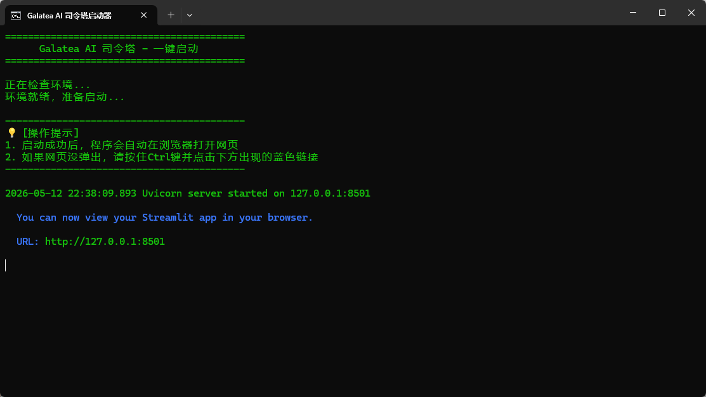
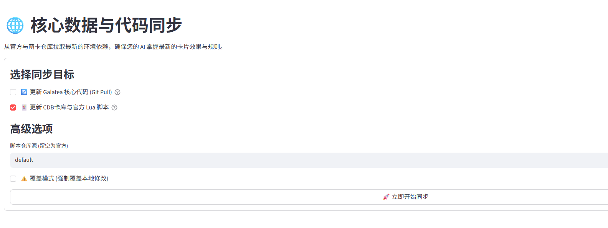
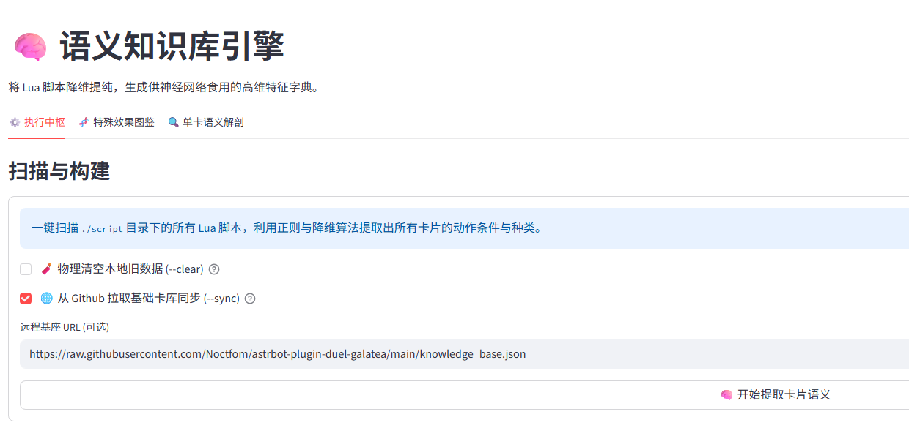
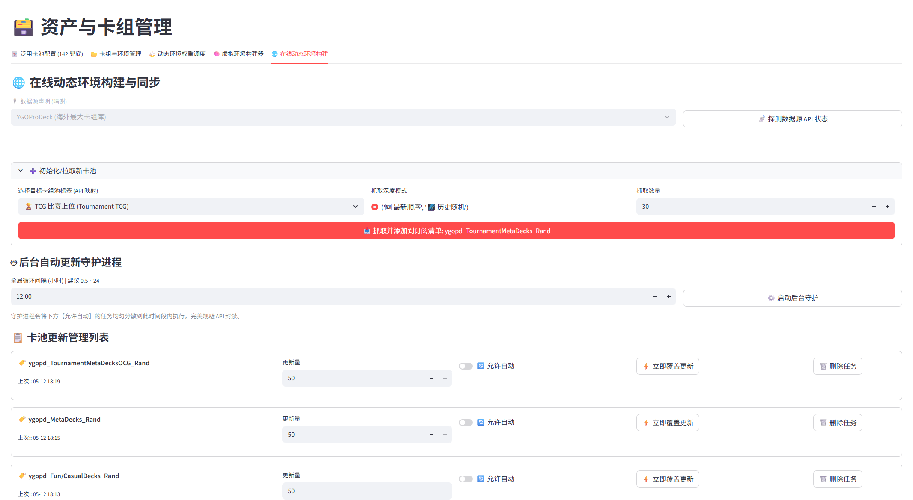
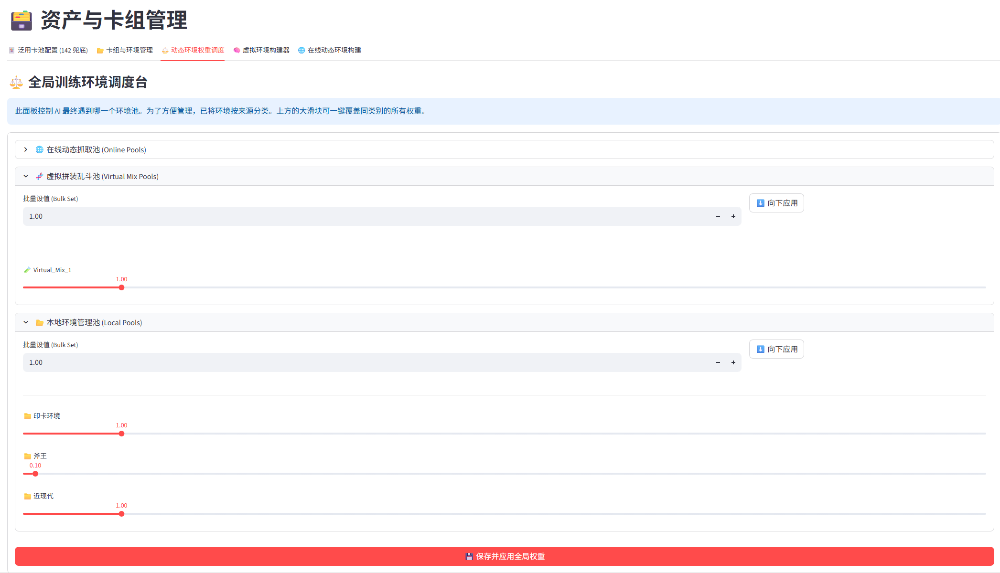
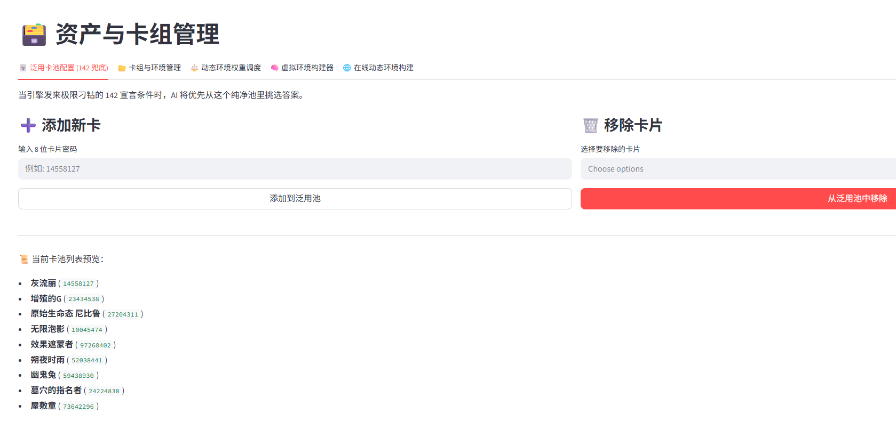

# 🚀 Quick Start Guide

> Configure your first training run in **5–10 minutes** when the environment and assets are ready. Initial downloads or full semantic generation may take substantially longer.

> This document applies to **Galatea-Core v3.15.8**, Model Protocol V4 / Checkpoint Format 3.

> See the [3.13.4 semantic-asset guide](code_semantics_en.md) for builds/sync and quality checks. Modern source/vector/index/provenance files form one bundle; changed semantic identities cannot share old checkpoints.

---

## 📋 Table of Contents

- [One-Click Launch](#one-click-launch)
- [Sync Resources & Card DB](#sync-resources--card-db)
- [Build Semantic Knowledge Base](#build-semantic-knowledge-base)
- [Prepare Decks](#prepare-decks)
- [Adjust Deck Weights (Optional)](#adjust-deck-weights-optional)
- [Configure the 142 Announcement Add-on Pool (Optional)](#configure-the-142-announcement-add-on-pool-optional)
- [RuleBot Stress Test (Optional)](#rulebot-stress-test-optional)
- [Start Training](#start-training)
- [View Training Results](#view-training-results)
- [Arena Model Testing](#arena-model-testing)
- [Independent Imitation Learning (Optional)](#independent-imitation-learning-optional)
- [[Alternate] Using Packaged Models](#alternate-using-packaged-models)

---

## One-Click Launch

### Windows Users

Double-click `一键包启动Webui.bat`. The launcher verifies and repairs dependencies before opening
`http://127.0.0.1:8501`.



> 💡 If the browser does not open, manually visit `http://127.0.0.1:8501`

The current Windows bundle supports RTX 20/30/40/50 and GTX 16 series GPUs. Systems
without a compatible GPU automatically use CPU mode; GTX 10 and older GPUs need an older
PyTorch build compatible with their architecture for GPU training.

Maintainers can double-click `构建一键包.bat` in the project root to create a release.
After validation, it writes `Galatea_Core_Vx.x.x.zip` without including local models,
logs, or training data.

If a large CUDA runtime makes the ZIP reach GitHub Release's 2 GiB per-file limit, the
builder automatically creates approximately 1900 MiB `.partNNN` volumes, a SHA256
manifest, and a Windows merge script. Upload all parts, the manifest, and
`Merge_Galatea_Core_Vx.x.x.bat`; after downloading them into one folder, users run the
script to reconstruct and verify the ZIP. `--allow-cpu-only` only relaxes CUDA validation
and does not uninstall or trim existing CUDA files. Use
`build_portable_package.py --split-existing <ZIP>` to split an existing oversized archive
without recompressing it.

### Linux Users

See [README_EN.md](../README_EN.md#linux-users). Activate an existing Python3.10+/Conda environment and run `bash setup.sh --install-only`. No new venv is created; an existing Torch is constrained to its full version. By default the script checks the bundled WindBot program and installs missing Mono/SQLite runtime packages through apt on Ubuntu/Debian, without build tools. The Windows portable environment cannot be copied to Linux.

```bash
bash setup.sh --check                    # Read-only; no installation or resource updates
bash setup.sh                            # Initialize and launch WebUI
bash setup.sh --train --workers 6         # Initialize and train, retaining --no_compile
bash setup.sh --skip-windbot --install-only  # Skip optional WindBot prerequisites
bash setup.sh --python /path/to/python --install-only
```

`--python` or `GALATEA_PYTHON` selects an interpreter; otherwise the current PATH's `python` is preferred, preserving an activated environment. Without Torch, installation follows `requirements.txt` and the current pip source. Install a specific build manually first, or set `GALATEA_TORCH_INDEX_URL=<wheel-source> bash setup.sh --install-only`; this source applies only when Torch is absent. cu121 is no longer hardcoded. Broken existing Torch or dependency conflicts stop instead of replacing it. For distribution-managed Python, activate a writable environment; the script never uses `--break-system-packages`. Installation mode fetches missing card/script resources through the existing `main.py update --data`; read-only mode only reports missing files.

---

## Sync Resources & Card DB

Go to **🔄 Resource Sync Hub**:

1. Check **🃏 Update CDB Database & Official Lua Scripts**
2. Click **🚀 Start Sync**



Wait a few minutes. This updates `cards.cdb`, official `script/`, and the repository-authoritative `card_vocab.json`. Advanced options may point to a custom CDB file source, vocabulary repository/file source, and script repository. If the CDB contains cards not yet numbered by that vocabulary, the runtime remains usable while affected decks temporarily leave random pools; inspect them under Assets & Decks → Deck & Pool Manager → Deck Compatibility Preflight.

Official environments should synchronize the repository vocabulary directly. For custom cards, use **Resource Sync Hub → Local/Custom Card Vocabulary** and acknowledge the warning before appending IDs from a local CDB. The CLI equivalent is `python main.py vocab --cdb <custom-cdb-path>`. Back up and distribute the resulting `card_vocab.json` to every training/deployment machine; forks created by different append orders cannot be merged automatically.

---

## Build Semantic Knowledge Base

Go to **🧠 Semantic Knowledge Engine**:

1. Select **🌐 Sync Remote Semantic Assets Only** when only repository assets are needed; this downloads without scanning local Lua
2. Select **🧬 Extract/Continue Local Semantics** to process the current `script/`; structured semantics and code vectors continue incrementally
3. Combine **Clear Local KB** with local update only for an intentional from-scratch build; sync and local update may be selected together to sync first and then continue
4. The remote base now defaults to the Galatea repository URL while legacy raw `knowledge_base.json` links remain accepted



> 📖 See [Special Handling - Semantic KB](special_handling.md#语义化模块semantic-kb) for Hash clustering details.

Wait for parsing to complete (first time may take several minutes). Structured knowledge, the Hash continuation index, and code-semantic vectors are stored together in the project root.

Starting in 3.9.0, training/Arena startup also compiles this bundle into an exact card-token × Lua-effect-slot table and embeds its logical prefix hash in model identity. Pure card/vocabulary appends remain compatible with older prefixes; changing existing-card semantics requires a new model lineage and cannot be bypassed by renaming files. Starting in 3.9.1, per-step observations no longer carry expanded semantic matrices; the network looks them up from card/effect-slot IDs without any new CLI or WebUI option.
Starting in 3.9.2, remote/local semantic updates pre-generate `semantic_lookup_v1.npz/.json`; training and Arena load them directly, while controlled source updates invalidate and rebuild them automatically. No new startup option is required, and these derived files should not be edited manually.

Training and Arena create reports only when **V3 Observation Audit (`--protocol-audit`)** is enabled; RuleBot self-check keeps it enabled by default. Inspect reports under **Semantic Knowledge Engine → V3 Observation Audit** or as raw JSON under `system_logs/protocol_v3_audit/`. Before the first real training run, use **Validate Semantic Bundle**.

The audit page/directory retain their historical “V3” names; the current model protocol remains V4. `known_observation_gap` records known gaps. Types37/38,120,160/165 and162 were completed in3.13.3, so their normal occurrence alone is not a current error. Type35 bulk exchange and Type161 Tag still have support limits; retain gap reports rather than patching a private Core.

---

## Prepare Decks

Multiple ways:

### Method 1: Use bundled test decks

The one-click package includes several `.ydk` test decks ready to use.

### Method 2: Manual upload

Go to **🗃️ Assets & Deck Management → 📂 Deck & Pool Manager**:
- Drag your `.ydk` files into the upload area
- Create subfolders for categorization (e.g. `tier1_meta`, `fun_decks`)

### Method 3: Online fetch (Recommended)

Go to **🗃️ Assets & Deck Management → 🌐 Online Fetcher**:
- Select target label (e.g. `🏆 Tournament TCG`, `⚔️ Meta Decks`)
- Set fetch quantity
- Click fetch to batch download decks automatically



---

## Adjust Deck Weights (Optional)

Go to **🗃️ Assets & Deck Management → ⚖️ Dynamic Pool Weights**:

- Set weight for each pool (0.0 ~ 10.0)
- Higher weight = AI trains more in that environment
- Adjust anytime, takes effect next game



> 📖 See [Special Handling - Global Weights](special_handling.md#卡组权重调整global-weights)

---

## Configure the 142 Announcement Add-on Pool (Optional)

Go to **🗃️ Assets & Deck Management → 🃏 142 Announcement Add-on Pool**:

- Own Main/Extra cards, known hands, and public cards automatically supply candidates; there is no need to repeat full deck lists here
- Add common but currently unknown cards through `meta_staples.json` (defaults include Ash Blossom and Maxx "C"); every candidate still passes Core's predicate
- This is not a whitelist or guaranteed priority. Only an empty filtered pool triggers a database search under the same predicate
- Running processes cache this pool; restart affected training/duel processes after edits



> 📖 See [Special Handling - 142 Announce Pool](special_handling.md#142-宣言池包装逻辑)

---

## RuleBot Stress Test (Optional)

Go to **⚔️ Launch & Monitor Hub → 🛠️ Rules Self-Check**:

- Set game count (recommend 50-100)
- Start to verify engine & script stability
- Run once before first training to ensure environment is healthy

---

## Start Training

Go to **⚔️ Launch & Monitor Hub → 🔥 Start Training (Train)**.

### Parameter Classification

Galatea-Core's training parameters are divided into three tiers:

| Tier | Parameters | Characteristics |
|------|-----------|-----------------|
| 🧠 **Brain Structure** | `d_model`, `n_heads`, `n_layers` | Like AI's brain capacity — fixed after definition (model architecture is locked) |
| ⚙️ **Training Config** | `batch_size`, `mini_batch`, `workers`, `timeout`, `device`, `no_compile`, plus RL hyperparameters below | Can be freely adjusted when resuming training |
| 🗂️ **Environment Config** | Deck weights, virtual pools, staple pool | Fully decoupled from training module, adjustable in real-time during training |

> ℹ️ When resuming, brain structure params are auto-locked from checkpoint. Training and environment configs can be freely modified.

> 🔐 New training automatically generates a read-only UUID. Resume inherits the UUID, model prefix,
> and embedded iteration. Filenames are descriptive; resume progress follows embedded metadata. The
> WebUI warns and rejects direct resume when the checkpoint protocol version differs.

### Parameter Quick Reference

| Parameter | Description | Beginner | Memory/VRAM Impact |
|-----------|-------------|----------|---------------------|
| **Checkpoint Loader** | "None" = train from scratch | None | - |
| **Model Prefix** | Output prefix for new models; inherited on resume | galatea | - |
| **d_model** | 🧠 Feature dimension (larger = more capacity) | 256 | ⬆️ RAM/VRAM |
| **n_heads** | 🧠 Attention heads | 4 | ⬆️ RAM/VRAM |
| **n_layers** | 🧠 Transformer layers | 2 | ⬆️ RAM/VRAM |
| **Iteration Mode** | Train to an absolute iteration or add iterations from a checkpoint | Add 1000 | - |
| **Batch Size** | Steps per collection | 4096 | ⬆️ RAM (primary) |
| **Mini Batch** | PPO update batch | 256-512 | VRAM in CUDA mode; RAM in CPU mode |
| **Workers** | Parallel worker processes | 4 (by CPU cores) | ⬆️ RAM (primary) |
| **Timeout** | Worker single-collection timeout | 300s | - |
| **Training Device** | auto / cpu / cuda | auto | Controls central inference and PPO device |
| **Export ONNX** | Synchronous historical-opponent export at checkpoints | As needed | Extra storage |
| **Disable Compile** | Recommended on Windows | On | - |

> 💡 **RAM/VRAM Tuning Rule**: `batch_size` and `workers` mainly consume RAM. In CUDA mode, `mini_batch` mainly consumes VRAM. Reduce workers for RAM pressure, reduce mini_batch or use `device=cpu` for VRAM pressure. Central batched inference is always enabled, and worker count should not exceed physical CPU cores.

### Recommended Configurations

#### 🧪 Beginner Test (Quick Validation)

| Parameter | Value |
|-----------|-------|
| d_model | 128 |
| n_layers | 2 |
| Target Iterations | 100 |
| Batch Size | 2048 |
| Mini Batch | 128 |
| Workers | 2 |
| Training Device | cpu or auto |
| Timeout | 300 |

#### 🏆 Full Training (Competitive)

| Parameter | Value |
|-----------|-------|
| d_model | 512 |
| n_layers | 6 |
| Target Iterations | 5000+ |
| Batch Size | 16384 |
| Mini Batch | 256 |
| Workers | 6-8 |
| Training Device | auto (prefers CUDA) |
| Timeout | 600 |

Click **🔥 Start Training Process**.


> 📖 Full CLI parameter reference: [Feature Guide - CLI Mode](features_en.md#cli-mode)

---

## View Training Results

### Live Logs

After training starts, view real-time logs at the bottom of **⚔️ Launch & Monitor Hub**.

### TensorBoard Curves

See the [TensorBoard Metric Reference](tensorboard_metrics_en.md) for every fixed chart's purposes, axes, aggregation and trend interpretation.

Go to **📉 Training Manifold**, click **🚀 Start TensorBoard** to view:

| Key Metric | Ideal Trend |
|------------|-------------|
| `Train/Total_Loss` | Need not decrease monotonically; watch for non-finite values and persistent discontinuities |
| `Train/Entropy` | Slowly decreasing |
| `Train/Approx_KL` | Small, with no persistent spikes |
| `Train/Clip_Fraction` | Moderate, not persistently near 0 or 1 |
| `Train/Explained_Variance` | Rising from 0 toward 1 |
| `Train/Gradient_Norm` | Finite, with no persistent spikes |
| `Rollout/Average_Reward` | Compare smoothed trends within the same opponent category |
| `League_Overall/WinRate_Total` | Interpret together with Rule/Self/Hist splits |
| `Performance/Rollout_Steps_Per_Second` | Stable or increasing |
| `Auxiliary_Train/Total_Loss` | Compare smoothed trends only within the same version; it is not on the PPO-loss scale |
| `Auxiliary_Train/Backbone_Scale` | Zero for 100 updates, then linearly rises to 0.2 over 900 updates |
| `Auxiliary_Train/Boundary_Accuracy` | Should rise after coverage stabilizes; interpret with `Auxiliary_Targets/coverage_next` |
| `Auxiliary_Train/Terminal_Accuracy` | Counts genuine Core-terminal labels only, never timeout/truncation as truth |
| `Planning/Total_Loss` | Compare smoothed trends only within one version and interpret with components plus target coverage |
| `Planning/Latent_Active_Dimension_Fraction` | Should not remain near zero; a low value may indicate latent collapse |
| `Planning/Pair_Cosine` | Adjacent same-turn/same-phase goals should become steadier, but need not approach 1 |
| `Planning/Policy_Gate_RMS` / `Value_Gate_RMS` | Should open gradually from zero; persistent zero means no decision effect, while rapid saturation needs review |
| `Planning/Gradient_Norm` | Should stay finite without persistent spikes; interpret separately from `Train/Gradient_Norm` |

`Planning_Histograms/Plan_Latent`, `Policy_Gate`, and `Value_Gate` record distributions every 200
updates to reveal collapse, concentration in a few channels, or premature gate saturation. These are
training diagnostics, not directly nameable “attack/defense/combo” explanations, and they do not
automatically create natural-language plans in Holographic Replay.

### PPO Update Controls (3.13.0)

Since 3.13.0, advanced training settings expose GAE lambda (default 0.98), PPO epoch limit (4),
and target KL (0.02; 0 disables the finite threshold). CLI equivalent:

```bash
python main.py train --gae_lambda 0.98 --ppo-epochs 4 --target-kl 0.02 --no_compile
```

TensorBoard `PPO_Update/Effective_Epochs` is updated samples divided by valid rollout samples;
`Epochs_Completed` counts complete traversals and `KL_Early_Stop` flags stopping. Different values
are not inherently errors. `Approx_KL_P95` / `Clip_Fraction_P95` summarize mini-batch means, not
individual-action distributions. Current controls appear under the text tab `Configuration/PPO`.
Repeated first-mini-batch stops require checking sampling/update modes and old log-probabilities
before relaxing thresholds.

KL stopping ends only the **remaining updates of this rollout**, not training, and does not undo
completed optimizer steps. Default target0.02 gives an actual `1.5×0.02=0.03` threshold checked
before the triggering mini-batch's backward pass. Policy/value/auxiliary/planning updates stop
together; the next iteration collects with the updated policy. Occasional stops are not errors
or evidence of convergence. With31,648 valid samples and512-sized batches, an epoch has61 full
mini-batches;165 completed updates equal about2.67 effective sample reuses, not “no learning”.
See [KL interpretation and metrics](architecture_en.md#interpreting-kl-early-stopping).

Enable “Record AI prediction curves” and a positive thought-log frequency in Arena to view both
players' state predictions in Holographic Replay. Manual calibration is not required to view them,
but they express AI understanding, not actual win rates. Remaining length means both players'
decision-transition events, not turns. This diagnostic requires full PTH; standard ONNX still
outputs only logits/value. New recordings evaluate model sides on every recorded event/decision snapshot;
the cursor follows the zero-based timeline and hover identifies message mirrors or corrected decisions.
Legacy recordings are not recomputed. Extra state inference can increase logged-game duration and file size,
not training costs. Coverage diagnostics explain gaps. See [curves and playback](core_trajectories_en.md#prediction-curves-and-playback-position).

### Meta Dashboard

Go to **📈 Meta Dashboard** to view win rate stats and counter matrix.

---

## Arena Model Testing

After training, go to **⚔️ Launch & Monitor Hub → 🏟️ Start Arena (Duel)**:

1. **P0 Model**: Select your trained `.pth` model
2. **P1 Model**: Select "None" to fight RuleBot
3. Select both deck sources. The default “P0 weighted current ranges + P1 follow P0 range” preserves previous behavior. You may instead pin a physical pool, virtual pool, exact deck, or mirror P0's exact deck
4. Select a mode: Normal Arena is for quick random play; Arena Benchmark freezes decks/seeds and alternates seats for model comparisons
5. Select a decision policy: Training Distribution best reflects training behavior, Greedy is a deterministic stress check, and Deployment Sampling can start at temperature 0.8
6. Set game count and thought-log frequency, then click **⚔️ Start Arena Process**

Normal results are viewable in **📈 Meta Dashboard**, and AI decisions in **👁️ Holographic Replay**. Benchmark results appear below the Arena form. Compare model versions by selecting “Reuse an existing schedule” and keeping the same policy and temperature.


---

## Independent Imitation Learning (Optional)

Open **Launch & Monitor Hub → Independent Imitation**. Collect teacher demonstrations, or process
existing replays in one action covering checks, reconstruction and preparation. By default, different
complete games from the same teachers form train/validation/test splits; separate executors are optional,
as is training on everything. Select the dataset/V4 checkpoint, explicitly run BC epochs, then optionally
evaluate known-teacher regression or held-out opponents. Collection/playing evaluation need WindBot
runtime; replay preparation and BC do not start it. Core starts randomize by default with a fixed-seed
option; split and optimizer seeds are separate.

Prepared data lives under `replay_data/imitation/`, checkpoints under `models/imitation/<run_id>/`,
and TensorBoard logs under `runs/imitation_<run_id>/`. Epochs count passes over demonstrations;
action accuracy is not playing win rate. This workflow starts neither PPO nor online-human learning,
and ordinary duels are not automatically demonstrations. Main training accepts BC as an explicit
weight source via `train --init-from`, never restoring its optimizer. Filenames retain independent
PPO/BC counters, e.g. `galatea_iter_200_bc_5.pth`. Model management/packaging list BC/PPO directories;
evaluation replays include AI prediction curves by default and appear in Holographic Replay.

See [Independent imitation learning](core_trajectories_en.md#3153-independent-imitation-workflow)
for collection, preparation, training, resume and evaluation CLI examples.

---

## [Alternate] Using Packaged Models

If you received a `.gkg` packaged model:

1. Go to **📦 Model Deployment → 📤 Unpack & Import**
2. Place `.gkg` in local packages folder
3. Select to unpack, check desired model/knowledge files
4. Click import

Imported models appear in `./models/`. Jump to [Arena Testing](#arena-model-testing) or [Holographic Replay](#view-training-results).

---

## Next Steps

- 🎞️ Use [Canonical Core trajectories and state-evaluation replay](core_trajectories_en.md): enable Arena recording options, turn on evaluation curves in replay, or run read-only `trajectory-check --replay`
- 🧪 Process external replays in Independent Imitation → tab1; Storage & Logs only views/downloads/cleans source and batch files. Readable YRP/partial Link data does not automatically qualify for learning
- 🧩 Optional [WindBot integration](../integrations/windbot/README.md): install separately for controlled Arena duels or explicitly enable WindBot opponents on the main training page. `python main.py windbot --inspect` checks executors/runtime; ordinary duels do not train automatically
- 📚 Read [Feature Guide](features.md) for detailed module usage
- 🔧 Read [Architecture](architecture.md) for framework internals
- 🧬 Read [Special Handling](special_handling.md) for unique features

Issues? [GitHub Issues](https://github.com/Noctfom/Galatea-Core/issues) or QQ Group **492420925**

📧 Contact: noctfom114514@outlook.com
